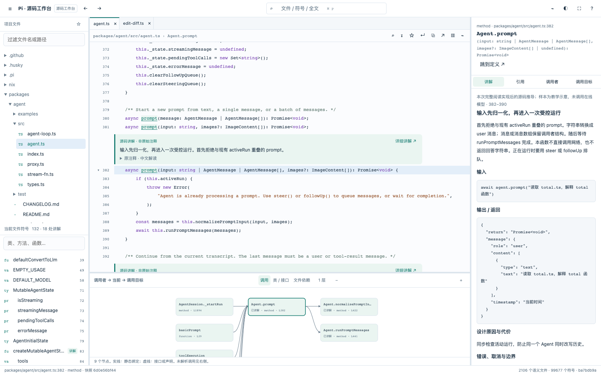
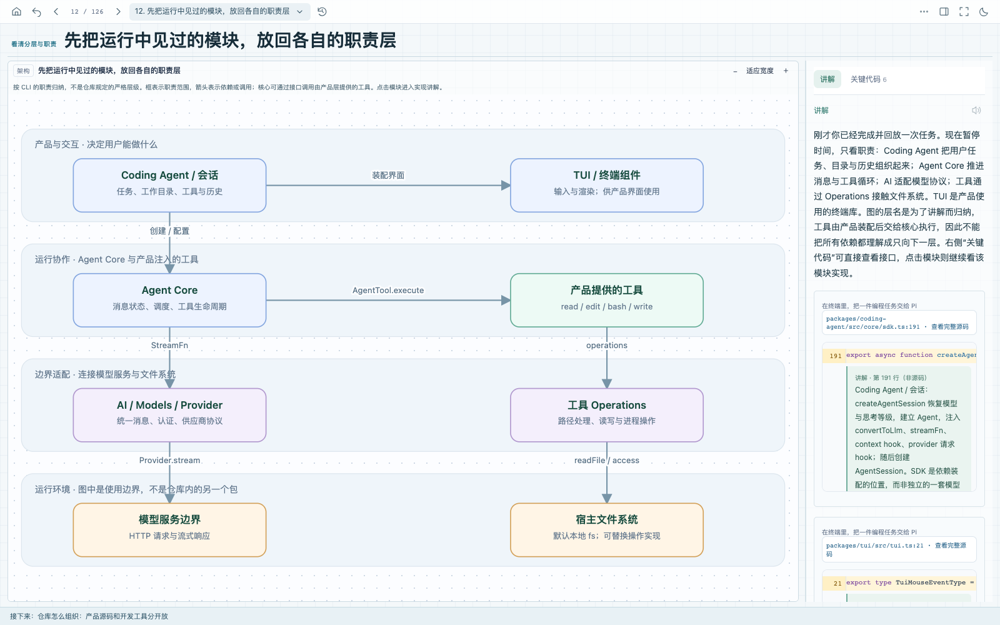

# My Skills

可复用的 Agent Skills，用于项目理解、架构分析等开发任务。

## Skills 清单

| Skill | 功能 | 适用场景 |
| --- | --- | --- |
| [source-insight](skills/source-insight/SKILL.md) | 生成类似 Source Insight 的离线源码工作台，提供文件/符号搜索、定义与引用、调用和类型关系、关键函数与调用链讲解 | 深入阅读源码、追踪调用、理解状态与维护代码 |
| [project-understanding](skills/project-understanding/SKILL.md) | 分析项目架构、模块职责与设计取舍，生成带交互图解、运行流程、数据样本和源码导航的离线网站 | 接手项目、阅读源码、架构梳理、团队入门 |

### source-insight

[](docs/previews/source-insight.png)

*以 Pi 项目生成页面为例，点击图片查看大图。*

直接进入源码工作台，不按 PPT 编排。文件树、当前文件符号、代码和关系面板共同导航，调用图与真实文件位置联动。

- **源码阅读**：多标签、前后跳转、行号定位、函数折叠、语法着色、文件内查找、书签、复制原始代码、本地编辑器定位、全屏和夜间模式；可隐藏和调整各面板。
- **导航与关系**：全局文件、符号和全文搜索；JS/TS 编译器静态定义与引用、调用者与调用目标、类与接口继承、文件导入关系；区分实际使用位置和声明位置。
- **深入讲解**：函数上方显示短摘要，一键打开右侧的参数、返回值、状态变化和设计分析；符号列表、搜索与调用图标出已讲解位置。支持原注释中文解读与原文对照，优先覆盖重要或复杂实现；调用链明确区分直接调用、回调与协议边界。
- **分析范围**：内置 JS/TS 语义索引，其他语言提供文本阅读与搜索；接口、动态调用和未知目标明确标记。只读快照，不宣称具备完整运行时调用分析、调试或重构。

默认生成 `source-guide/dist/index.html`，直接用浏览器离线打开。需要 Node.js、Git，以及提供 `createProgram` API 的 TypeScript 编译器。可通过 `--compiler` 指向本机已有兼容版本，不必修改目标项目依赖。分析内容由 Agent 阅读源码后编写，自动索引不等于每个函数已有人工讲解。

### project-understanding

[](docs/previews/project-understanding.png)

*以 Pi 项目生成页面为例，点击图片查看大图。*

先用具体任务、界面和运行结果说明项目用途，提供可以照做的快速体验。再从目标项目提取项目名、技术栈、模块和调用关系，沿“总架构 → 子架构 → 模块 → 机制与代码”逐层下钻。每页上方是当前层的图，模块图下直接并排展示输入、处理和输出，用短样本解释字段；下方用具体场景讲解设计、运行和源码，避免重复问卷式标题；通过图节点与可收起的树状侧栏导航；侧栏包含架构层级、真实项目文件和 Git 历史，可快速搜索文件、提交并与图解联动。

- **连续讲解与上手**：先安装配置、用一个输入完成任务并验证输出，再回放数据流、进入各层代码和设计取舍；按理解依赖组织章节，区分普通使用、源码开发与部署。支持界面示例、全屏、章节跳转和模块下钻；可用时提供无需外部账号的本地练习，并说明替身范围。
- **架构图解**：从总览深入实际机制，展示参与者、关键分支、状态与数据变化；检查整个课程中的重复占位图，保留节点下钻和代码入口。
- **核心设计**：从实际约束和实现中提炼项目最值得理解的设计，沿专题图解查看简单方案的不足、关键机制、数据变化、源码与代价；区分证据和推断，不以通用术语冒充亮点。
- **代码讲解**：在对应模块中阅读关键片段，再打开带行号的完整源码，支持浅色语法高亮、引用入口行标记、行号跳转、前后匹配查找、换行、复制和本地编辑器定位。
- **Git 历史**：最近约三个月的日志、分支 tip 比较、统一/左右 diff、关键变更解读及当前架构关联；仅使用本机已有引用，范围和截断可见。
- **完整流程动画**：用一个任务从安装和启动演示到最终结果，支持播放、暂停、步进、调速和阶段跳转；模块、连线、数据、界面结果与源码同步变化，并标明真实捕获和示意范围。
- **运行样本**：展示关键边界的中间数据，区分实际捕获与模拟示例。
- **LLM 上下文**：针对 AI 项目，展示系统指令、工具声明、历史消息及模型请求的组成。

默认生成 `architecture-guide/dist/index.html`，可直接用浏览器离线打开。

## 安装

### Codex

克隆仓库：

```sh
git clone https://github.com/waruqi/my-skills.git
cd my-skills
```

安装所需 skill（将 `skill_name` 设为 `source-insight` 或 `project-understanding`）：

```sh
skill_name="source-insight"
skill_source="$PWD/skills/$skill_name"
skill_target="${CODEX_HOME:-$HOME/.codex}/skills/$skill_name"
mkdir -p "$(dirname "$skill_target")"
if [ -e "$skill_target" ] || [ -L "$skill_target" ]; then
  printf '已存在，未覆盖：%s\n' "$skill_target"
else
  cp -R "$skill_source" "$skill_target"
fi
```

安装后在下一轮调用。其他支持 `SKILL.md` 的工具，可将完整 skill 文件夹放到对应的技能目录。

### 不安装，直接使用

在目标项目中让 Agent 读取克隆目录下所需的 `skills/<skill-name>/SKILL.md`，按其中的流程执行即可。

## 用法

在要分析的项目中调用源码工作台：

```text
$source-insight 分析当前项目，生成中文源码工作台。
提供文件与符号导航、引用和调用图，重点解释关键调用链、参数、返回值与错误处理。
```

生成架构学习网站：

```text
$project-understanding 分析当前项目，生成中文架构学习网站。
包含可点击架构图、完整运行流程、中间数据、源码导航和设计取舍。
```

也可以指定重点：

```text
$project-understanding 重点解释一次请求从入口到存储的完整过程，
展示每一步的数据格式、错误处理和对应源码。
```

构建架构学习网站需要 Python 3.9+ 和 Git；运行样本需要目标项目自身的依赖。项目分析由 Agent 完成，构建脚本负责校验与打包。

### 更新已有网站

先让 Agent 根据代码变更更新分析内容和样本。当前模板使用分层页面格式（schemaVersion 2）；旧版内容需让 Agent 重新组织为可从图逐层进入的页面。随后在目标项目根目录运行以下命令，将 `/path/to/skill` 替换为 `project-understanding` 的安装目录：

```sh
python3 /path/to/skill/scripts/build.py \
  --root . \
  --content architecture-guide/content.json \
  --out architecture-guide/dist
```

## Skill 目录结构

```text
skills/project-understanding/
├── SKILL.md             # 使用说明与执行流程
├── agents/openai.yaml   # Codex 技能信息
├── references/          # 内容格式与图形协议
├── scripts/build.py     # 网站构建器
└── assets/              # 网页模板与交互图形渲染器
```

### 更新源码工作台

让 Agent 先核对变化并更新 `source-guide/analysis.json`，再重新生成静态索引和页面：

```sh
node /path/to/source-insight/scripts/build.mjs \
  --root . \
  --analysis source-guide/analysis.json \
  --out source-guide/dist
```

若项目安装的 TypeScript 没有所需编译器 API，附加 `--compiler /path/to/typescript/lib/typescript.js` 指向已安装的兼容版本。不要为分析而降级产品依赖。`--config` 可指定项目内配置文件；多配置项目需要核对覆盖范围。

```text
skills/source-insight/
├── SKILL.md                      # 分析方法与使用边界
├── agents/openai.yaml            # 技能信息
├── references/analysis-format.md # 函数与调用链讲解格式
├── scripts/build.mjs             # 编译器索引与网站构建
├── scripts/pack.mjs              # 关系数据压缩与界面打包
├── scripts/build.test.mjs        # 语义绑定和边界验证
└── assets/                       # 离线源码工作台
```
